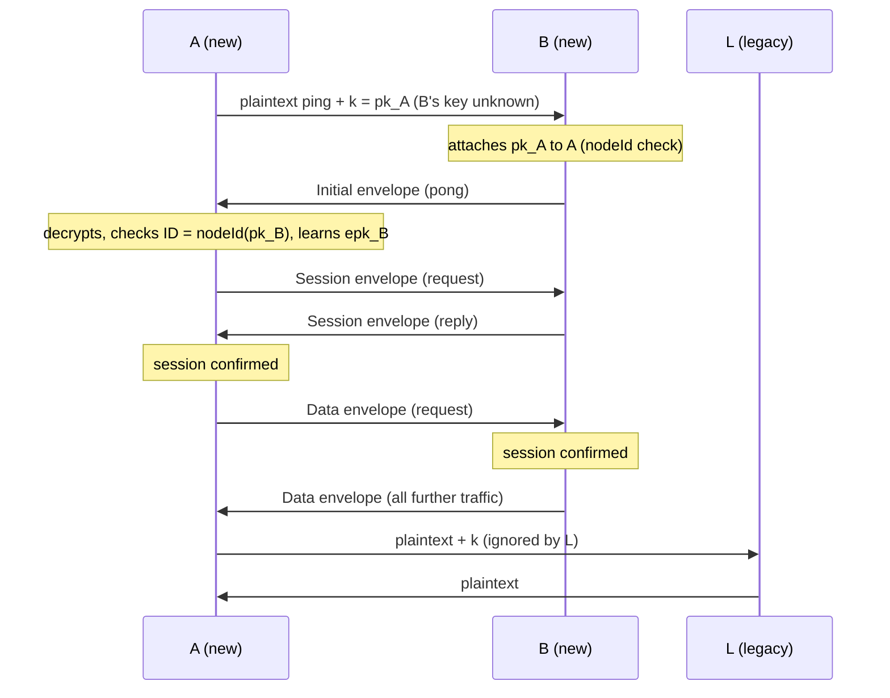
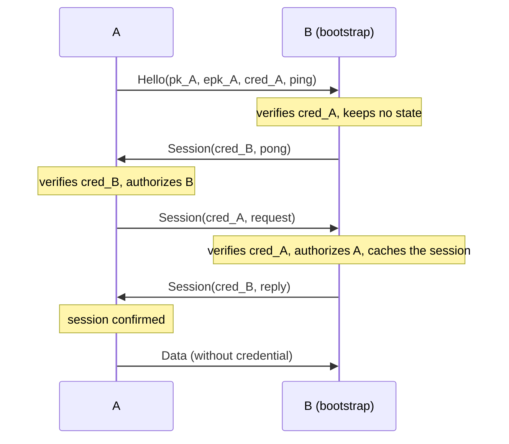

# Transport encryption: cryptographic design

This document specifies how OpenDHT encrypts and authenticates the UDP DHT protocol between nodes (the "transport"), and how private networks restrict participation with a small public-key infrastructure.

Implementation: [include/opendht/transport.h](../include/opendht/transport.h), [src/transport.cpp](../src/transport.cpp), and the send/receive paths in [src/network_engine.cpp](../src/network_engine.cpp).

## 1. Scope

### Goals

- **Confidentiality and integrity** of DHT protocol messages exchanged between two nodes that both support encryption.
- **Authenticated node IDs**: a node can only send encrypted messages under the node ID that derives from its own key.
- **Backward compatibility**: nodes without this feature keep working with new nodes, in plaintext.
- **Optional private networks**: when configured, a node only talks to nodes holding a credential signed by a trusted authority.
- **Forward secrecy**: recorded traffic stays confidential after a node's long-term key is compromised, once the ephemeral keys used for it are erased (at most one hour later). The first packet to a peer has weaker guarantees ([§5.2](#52-key-schedule)).
- **Address validation**: a Session or Data envelope proves that its sender receives packets at its source address. It replaces the legacy write tokens between encrypted nodes ([§6.6](#66-write-authorization)).
- **Low cost**: no handshake round trip, a few X25519 operations per peer every 30 minutes. Once a session is established, 30 bytes of overhead per packet, minus the 40-byte token in messages that carried one.

### Non-goals

- **End-to-end protection of values.** Encryption is hop-by-hop. Nodes storing a value see it in clear. Use `SecureDht` (signed or encrypted values) for end-to-end protection. `SecureDht` identities are unrelated to transport keys.
- **Hiding metadata**: packet sizes, timing and addresses are visible, and so are the sender's public keys until a session is established.
- The REST proxy (`DhtProxyServer`/`DhtProxyClient`) and local peer discovery are not covered.

## 2. Notation

| Notation | Meaning |
|---|---|
| `a ‖ b` | Concatenation of byte strings |
| `"text"` | ASCII bytes, without terminator |
| `u32be(x)`, `u64be(x)` | Unsigned integer, big-endian, 4 or 8 bytes |
| `sk_A`, `pk_A` | Static transport secret and public key of node A |
| `esk_A`, `epk_A` | Ephemeral secret and public key of node A for the address of its peer |
| `DH(x, Y)` | `X25519(x, Y)` |
| `N` | Network ID (`Config::network`, 32-bit, `0` by default) |
| `K_A→B` | Key encrypting envelopes from A to B |

All keys are 32 bytes. Integers on the wire are big-endian.

## 3. Primitives

| Purpose | Primitive | Reference |
|---|---|---|
| Key agreement | X25519 | RFC 7748 |
| Key derivation | HKDF-SHA256 | RFC 5869 |
| Packet encryption | ChaCha20-Poly1305 AEAD, 96-bit nonce, 128-bit tag | RFC 8439 |
| Node ID | SHA-256, truncated to 160 bits | FIPS 180-4 |
| Credential signature | Ed25519 | RFC 8032 |
| Randomness | `gnutls_rnd` (`GNUTLS_RND_KEY` for keys, `GNUTLS_RND_NONCE` for nonces) | |

Primitives come from Nettle (libnettle and libhogweed) and GnuTLS, which OpenDHT already depends on. All primitives are used through their standard interfaces with no modification. The authentication tag is compared in constant time. Secret keys are erased with `gnutls_memset`.

## 4. Keys and identities

### 4.1 Transport key

Each node has a static X25519 key pair, its long-term identity:

```
sk = 32 random bytes
pk = X25519(sk, 9)
```

The key is either given in `Config::transport.key`, or generated on start. A generated key is saved in the node state when `Config::persist_path` is set (see [§8](#8-key-persistence)). Otherwise, it changes on every restart, and so does the node ID.

The transport key is used only for the transport. It is independent of the `SecureDht` identity (an RSA certificate).

### 4.2 Node ID

When transport encryption is enabled, the node ID is derived from the public key:

```
nodeId(pk) = SHA-256("opendht-node-id-v1" ‖ pk)[0..20)
```

`Config::node_id` is ignored in that case. This binding is what authenticates node IDs: a receiver checks that the ID claimed inside a decrypted message equals `nodeId(pk)` of the static key the envelope was authenticated with (see [§6.5](#65-receiving)). Holding the ID therefore requires holding `sk`.

When encryption is disabled (`TransportConfig::enabled = false`), the node uses the legacy behavior: a random ID, or `Config::node_id`.

### 4.3 Network authority (private networks)

An authority is an Ed25519 key pair. Its secret is the 32-byte Ed25519 seed. Its public key identifies the private network, and nodes are configured with a list of trusted authority public keys (`TransportConfig::authorities`). A network is private if and only if this list is non-empty.

### 4.4 Credential (private networks)

A credential is an authority's signature binding a transport public key to an expiration time. It is 105 bytes:

```
offset size field
0      1    version = 0x01
1      32   pk         transport public key of the node
33     8    expiry     u64be, seconds since the Unix epoch
41     64   signature  Ed25519 signature by the authority
```

The signature covers:

```
"opendht-credential-v1" ‖ 0x01 ‖ pk ‖ u64be(expiry)
```

A credential is **valid** at time `t` when both of these hold:
- `t < expiry`, using the verifier's system clock;
- the signature verifies under at least one trusted authority.

Credentials are not bound to a network ID. An authority key therefore defines a network: use distinct authorities for distinct networks.

## 5. Key agreement

### 5.1 Ephemeral keys

Each node has an epoch secret `S`: 32 random bytes, replaced every 30 minutes (an *epoch*). Its ephemeral key for a peer at address `addr` derives from it:

```
addr      = IP (4 bytes for IPv4, including IPv4-mapped IPv6, else 16 bytes) ‖ port (2 bytes, network order)
esk(addr) = HMAC-SHA256(key = S, "opendht-address-key-v1" ‖ addr)
epk(addr) = X25519(esk(addr), 9)
```

- The node always sends to `addr` with `epk(addr)` from its **current** epoch.
- It still accepts envelopes addressed to its key from the **previous** epoch, so peers have one epoch to learn the new key.
- On rotation, the previous epoch secret and every key derived from it are erased.

An ephemeral secret therefore lives at most one hour. Epoch secrets are never persisted, and a restart starts with a new one.

Nodes learn each other's ephemeral key from the header of every envelope ([§6.1](#61-envelope)). A node records a peer's ephemeral key only from an envelope it authenticated.

`epk(addr)` is only ever sent to `addr`. Learning it therefore requires receiving packets at `addr`, or observing the path to it. This is what makes a Session envelope a proof of address ([§6.6](#66-write-authorization)). Deriving keys per address costs one more X25519 base-point multiplication per new address, and nothing per packet.

### 5.2 Key schedule

Each envelope from a sender A to a receiver B is encrypted with a key `K_A→B`, derived with HKDF-SHA256 (RFC 5869):

```
prk     = HMAC-SHA256(key = "opendht-transport-v2", ikm)
K_A→B   = HMAC-SHA256(key = prk, info ‖ 0x01)
```

The input keying material `ikm` and `info` depend on what A knows about B.

**Session**: A knows B's ephemeral key `epk_B`:

```
ikm  = DH(esk_A, epk_B) ‖ DH(esk_A, pk_B) ‖ DH(sk_A, epk_B) ‖ DH(sk_A, pk_B)
info = u32be(N) ‖ 0x02 ‖ pk_A ‖ epk_A ‖ pk_B ‖ epk_B
```

**Initial**: A doesn't know B's ephemeral key, typically on first contact:

```
ikm  = DH(esk_A, pk_B) ‖ DH(sk_A, pk_B)
info = u32be(N) ‖ 0x01 ‖ pk_A ‖ epk_A ‖ pk_B
```

B computes the same values with its own secrets, since `DH(x_A, Y_B) = DH(y_B, X_A)`. Any DH result equal to zero (a low-order public key) is rejected.

Properties:

- **Directional keys.** `info` orders the keys as sender, then receiver, so `K_A→B ≠ K_B→A`. Each node derives both from the same four DH values.
- **Authentication.** Every key includes `DH(sk_A, pk_B)`, so only the holders of `sk_A` or `sk_B` can produce or read the envelope. Every envelope thus proves possession of the sender's static key.
- **Forward secrecy.** A Session key includes `DH(esk_A, epk_B)`. Once both ephemeral secrets are erased, the key cannot be recomputed, even with both static secrets.
- **Key-compromise impersonation resistance.** With `sk_B`, an attacker still cannot impersonate A to B in a Session envelope: it cannot compute `DH(sk_A, epk_B)` without `sk_A` or `esk_B`.
- **Initial keys are weaker**, as for the first message of Noise IK. Without `epk_B`, an Initial key is only forward-secret against a later compromise of `sk_A`, not of `sk_B`. It also allows impersonating A to B with `sk_B`. Initial envelopes are only sent until A learns `epk_B`, usually for a single packet.
- **Binding.** `info` includes `N`, the envelope type and all public keys involved. Nodes with different network IDs cannot decrypt each other's packets.
- **Cost.** A Session key costs four X25519 operations, plus one for our ephemeral key. It is cached in the epoch, so it is derived once per peer address and ephemeral key pair, once the peer has proven to receive at that address ([§6.5](#65-receiving)). An Initial key costs two X25519 operations, plus one for our ephemeral key, and is not cached. Each epoch caches at most 16384 sessions, evicting the least recently used; beyond that, keys are derived for each packet.

## 6. Wire protocol

### 6.1 Envelope

Initial and Session envelopes carry the sender keys:

```
offset size        field
0      1           marker = 0xC1
1      1           type: 1 = Initial, 2 = Session, 3 = Hello; | 0x80 if a credential is included
2      32          pk_sender
34     32          epk_sender
66     12          nonce (random)
78     len         ciphertext
78+len 16          Poly1305 tag
```

Once the session is confirmed ([§6.4](#64-sending)), Data envelopes leave them out. The receiver finds the session keys from the source address:

```
offset size        field
0      1           marker = 0xC1
1      1           type = 4 (Data), never with a credential
2      12          nonce (random)
14     len         ciphertext
14+len 16          Poly1305 tag
```

- The ciphertext is `ChaCha20-Poly1305(K_sender→receiver, nonce, plaintext, aad = header)`.
- The header is bytes `[0, 66)`, or `[0, 2)` for Data: marker, type, and the sender keys. Because it is the associated data, an attacker cannot change the type, the credential flag or the sender keys without the tag check failing.
- The plaintext is the msgpack-encoded DHT message. With the credential flag, it is preceded by the sender's 105-byte credential.
- The overhead is 30 bytes for Data, 94 bytes for Initial and Session, or 199 bytes with a credential.
- Nonces are 96 bits from the system CSPRNG. For `n` packets under one key, the probability of a nonce collision is about $n^2 / 2^{97}$. Keys change at least every epoch, so this is negligible.

`0xC1` is the one byte value that msgpack never uses. Every legacy OpenDHT message is a msgpack map, which starts with `0x80`–`0x8F` or `0xDE`–`0xDF`. This marker therefore unambiguously separates envelopes from plaintext messages:
- legacy nodes fail to parse an envelope and drop it, without blacklisting the sender;
- new nodes still parse plaintext messages normally.

### 6.2 Hello (private networks only)

`Hello` introduces a node to a peer whose key is unknown. This happens when pinging a bare address, typically a bootstrap node. A Hello is **not encrypted**:

```
0xC1 ‖ 0x03 ‖ pk_sender ‖ epk_sender ‖ credential (105 bytes) ‖ msgpack ping
```

The sender cannot encrypt to a key it doesn't know, and X25519 keys cannot sign, so **a Hello proves nothing about its sender**. Its credential travels in clear and can be copied. The receiver therefore:

- answers only a ping, and only if the credential is valid for `pk_sender`;
- answers with a Session envelope to `pk_sender` and `epk_sender`, so only the holder of `sk_sender` can read the answer;
- keeps no state from the Hello: it does not add, move or authorize the claimed node.

The sender proves possession of its key with its next envelope.

### 6.3 Key advertisement in plaintext messages

New nodes add fields to plaintext msgpack messages. Legacy nodes ignore unknown fields.

| Field | Location | Content |
|---|---|---|
| `k` | top level | Sender's transport public key (bin, 32 bytes) |
| `k4` | reply body, next to `n4` | Concatenated public keys of the listed IPv4 nodes, 32 bytes per node, all-zero if unknown |
| `k6` | reply body, next to `n6` | Same for IPv6 |

Rules for using these fields:

- **`k` is sent only when it is needed**: in public mode, in plaintext messages to nodes whose key is not yet known. Encrypted messages do not need it, because the sender key is in the envelope header.
- **Listed keys are checked before use.** A key from `k`, `k4` or `k6` is attached to a node only if `nodeId(key)` equals the node's ID. Otherwise it is ignored.
- **The binding limits what a dishonest node can do with a node list.** It cannot attach a forged key to an existing node ID. It can still list a wrong address, which at worst causes encrypted packets to be sent to the wrong host. That host cannot read them.
- `k4` and `k6` are omitted if no listed node has a known key. They are ignored if their length is not exactly 32 × the number of listed nodes.

### 6.4 Sending

To send a message to node B:

1. If transport encryption is disabled, send plaintext.
2. If B's static key is known (B has a peer record), send an envelope with our ephemeral key for B's address:
   - a Data envelope if our session with B's address is **confirmed**;
   - otherwise a Session envelope if B's ephemeral key is known, or else an Initial envelope. In a private network, both include our credential.
3. Else, in a private network:
   - if B's ID is unknown (a ping to a bare address), send a `Hello`;
   - otherwise refuse to send (`EPERM`).
4. Else (public network, key unknown), send plaintext, including `k`.

Once a node's key is known, nothing is ever sent to it in plaintext. Failed key agreement, including a low-order public key, refuses the send (`EPERM`); it never falls back to plaintext.

**Confirmation.** A session with an address is confirmed when B shows that it holds the session keys and accepted us:
- B answers, in a Session or Data envelope, a request we sent to its node ID **in a Session or Data envelope**. B cached the session when it opened our envelope ([§6.5](#65-receiving)), and answered with keys of our current epoch. Requests sent in an Initial envelope or a Hello are excluded: B answered them without caching a session, so our next request is a Session envelope, and its answer confirms;
- or we receive a Data envelope under our current epoch. B only sends one after we confirmed it the same way.

The confirmation is lost when the session keys change: on epoch rotation, or when B's ephemeral key changes through accepted traffic. An Initial request leaves existing state untouched and is answered without reusing a cached session or its confirmation.

**Recovery.** On the first retransmission of a request, the node forgets B's ephemeral key. The retry is therefore an Initial envelope, with our credential in a private network. This recovers when B no longer has the session or our authorization, for example after a restart. In public mode, a plaintext read-only request claiming B's ID is answered with an Initial envelope to B's known static key. The answer uses a transient node record: it does not reset B's existing ephemeral key, address or session. A restarted peer can read this answer and establish a new session.

When value data is fragmented for a node with a known key, fragments are reduced to `1280 − 199 = 1081` bytes, so that each packet still fits in the 1280-byte IPv6 minimum MTU.

### 6.5 Receiving

For each received packet, a node applies the following checks in order:

1. **Address filters.** Drop the packet if it comes from a martian or blacklisted address. This is unchanged.

2. **Envelopes.** If the packet starts with `0xC1`:
   1. If encryption is disabled, drop it.
   2. Drop it if its type is unknown, or if `pk_sender` is our own key. This rejects reflected packets.
   3. **Hello:**
      - Drop it outside private networks, or if it carries no message.
      - Apply the rate limiter, then verify the credential: its key must equal `pk_sender` and it must be valid. Drop the packet on failure.
      - Continue with steps 4 and 5, then answer as described in [§6.2](#62-hello-private-networks-only). The Hello is not processed any further.
   4. **Initial:** apply the rate limiter, derive the Initial key from `pk_sender` and `epk_sender`, and decrypt.
   5. **Session:** first try the keys cached in each epoch for (source address, `pk_sender`, `epk_sender`). Otherwise, for our current epoch then the previous one: apply the rate limiter, derive the keys with our ephemeral key for the source address, and decrypt; on success, cache the keys in that epoch.
   6. **Data:** decrypt with the session cached for the source address in our current epoch, then in the previous one. Its `pk_sender` and `epk_sender` are those of the session. This needs no key derivation and no rate limiting.
   7. Drop the packet if it was not decrypted.
   8. **Credential flag:** strip the 105-byte credential. In a private network, verify it as for Hello, unless the peer is already authorized; on success, the peer is authorized until the credential expires.
      **No credential:** in a private network, drop the packet unless the peer is currently authorized.
  9. Record `epk_sender` on a temporary peer record. It is **validated for the source address** if the envelope was a Session or Data envelope: opening it required our ephemeral key for that address, which was only ever sent there. Existing peer state is updated only after parsing, ID binding and the processing checks below.

  **Session cache.** The epoch caches one session per source address. An entry is created or replaced only by a Session envelope that was opened (step 5), or when sending to the exact address for which the peer's ephemeral key is validated. Answers to Initial and Hello envelopes derive their keys without using or changing cached sessions: their source address may be spoofed, and caching would let anyone replace the session of the address's real owner, or fill the cache from forged addresses.

3. **Plaintext in a private network.** Drop any packet that is not an envelope.

4. **Parsing.** Parse the msgpack message and apply the network ID check. This is unchanged.

5. **Envelope ID binding.** For an envelope, the message's node ID must equal `nodeId(pk_sender)`, otherwise drop the message. Value data fragments are exempt because they carry no node ID. Instead, the parts of a fragmented message, keyed by source address and transaction ID, are bound to the envelope state of the first part received: all plaintext, or all in envelopes from the same `pk_sender`. A part that does not match is dropped, except that an encrypted part replaces plaintext state, which anyone can forge from a spoofed address. Transaction IDs are predictable, so without this binding a spoofed plaintext fragment, received first, would displace the real one.

6. **Plaintext with `k`.** For a plaintext message carrying `k`, attach the key to the sender if it matches the sender's ID.

7. **Processing.**
  - A Session or Data envelope can move the sender's node record to the packet's source address.
  - Initial requests use transient node records. Read-only requests are answered, writes receive `401`, and value updates are dropped. They do not add or move an established node, count as activity, or change its ephemeral key or session confirmation.
  - Initial replies and errors are accepted only for a pending request at the expected source address, never for a listener. They cannot move a known keyed node to a different address.
   - Replies and Data envelopes can confirm the session ([§6.4](#64-sending)).

  A **plaintext** message claiming the ID of a node whose key is known is untrusted, even from that node's recorded address:
   - it does not move the node record and does not count as activity from that node;
  - replies, errors, value updates and writes are dropped;
  - only read-only requests (`ping`, `find`, `get`) are answered, using a transient node record and an Initial envelope to the known key.

The rate limiter is the existing per-address and global request limiter. It runs before every expensive public-key operation on unauthenticated input:
- each Initial envelope (two X25519 operations);
- each Session envelope from an uncached (address, `pk_sender`, `epk_sender`) triple (five X25519 operations per epoch tried);
- each Hello (one Ed25519 verification, and the key derivation of its answer).

Packets from peers with cached session keys cost one AEAD operation. Each epoch caches at most 16384 sessions, evicting the least recently used one to store a new one. An evicted peer recovers after one retransmission. Only a peer that received a packet from us at its address can take a cache slot, so a slot costs the attacker a reachable address and a round trip.

### 6.6 Write authorization

`put`, `refresh` and `listen` create state on the receiver, and `listen` makes it send value updates to the requester's address. The receiver therefore requires proof that the requester receives packets at its source address. Without it, an attacker could spoof a victim's address to fill its storage quota, or direct update traffic to it.

- **Encrypted requests** must arrive in a **Session** or **Data** envelope. Our ephemeral key for the source address is only sent to that address ([§5.1](#51-ephemeral-keys)), so opening the envelope proves the sender received one of our packets there. Requests in Initial envelopes are refused with error `401`. The requester then forgets its sync state with us and sends a new `get`. The answer carries our ephemeral key for its address, and the request is retried in a Session envelope.
- **Plaintext requests** must carry a token, as in the legacy protocol. The token is sent in answers to `find`, `get` and `listen`, and in value updates, to the address of the node record:

  ```
  token(addr) = HMAC-SHA256(key = S, "opendht-address-token-v1" ‖ addr)
  ```

  A token is accepted in the epoch it was issued and the next one. Legacy nodes treat tokens as opaque, so changing their derivation keeps compatibility.

Messages to and from encrypted nodes carry no token. This saves 40 bytes in each answer to `find`, `get` and `listen`, and in each `put`, `refresh`, `listen` and value update. A node that receives an encrypted answer may write to its sender.

## 7. Message flows

### 7.1 Public network

Encryption is opportunistic, and keys travel with node IDs.



- The first request to a node with an unknown key, typically a bootstrap ping, is in plaintext. Its reply is an Initial envelope. The next request and its reply use Session envelopes, and all later traffic uses Data envelopes.
- Nodes learned through `k4`/`k6` get an Initial envelope as the first packet. Its answer is a Session envelope, but the answerer caches nothing yet: the next request is a Session envelope, and its answer confirms the session. Data envelopes follow.
- Legacy nodes see plaintext from new nodes and are unaffected.

### 7.2 Private network

Only nodes with a credential participate. Nodes never send or accept plaintext.



- **Credential exchange.** Each side attaches its credential to its Initial and Session envelopes. Data envelopes, sent once the peer has accepted us, never carry it.
- **Authorization lifetime.** A peer stays authorized until its credential expires, according to the local clock. After that, its packets without a credential are dropped.
- **Node lists.** Listed nodes without a valid matching key are discarded.
- **Startup checks.** The node refuses to start (`DhtException`) if:
  - encryption is disabled while authorities are configured;
  - the configured credential does not match the transport key;
  - the credential is not valid for the configured authorities.

  A warning is logged if the credential expires within a week. The credential is read once on start, so renewing it requires a restart.

## 8. Key persistence

If the following conditions all hold, the static secret key is saved in the state file as the msgpack field `transport_key` (32 bytes):
- encryption is enabled;
- no key was configured;
- `Config::persist_path` is set.

When the key is saved:
- the state file's permissions are set to `0600` before any data is written;
- on start, the key is restored before any packet is exchanged, so the node keeps its ID across restarts.

The node also stores its ID in the state file, so older versions reading this state keep the same ID. A configured key is never written to the state file. Ephemeral keys and session keys are never persisted.

`dhtnode --transport-key <file>` loads the raw 32-byte secret from `<file>`. If the file does not exist, `dhtnode` creates it with mode `0600`.

## 9. Security analysis

### 9.1 Properties

Against an attacker who controls the network but holds no node's secret key:

- **Confidentiality and integrity.** Traffic between two nodes that know each other's keys is confidential and integrity-protected. The protection is IND-CCA2 and INT-CTXT, from ChaCha20-Poly1305 under keys derived from X25519.
- **ID authentication.** An encrypted message under node ID `X` can only be produced by the holder of the static secret key behind `X`.
  - Producing a key for a given ID requires a SHA-256 preimage on 160 bits.
  - Choosing the first `b` bits of one's own ID costs about $2^b$ key generations. Legacy nodes choose their ID freely.
- **Forward secrecy.** Session envelopes recorded by the attacker stay confidential if static keys are compromised later, once both ephemeral secrets are erased (at most one hour after use). Initial envelopes stay confidential if the sender's static key is compromised, but not the receiver's.
- **Key-compromise impersonation.** With a node's static secret, an attacker can decrypt the Initial envelopes sent to it and impersonate other nodes to it in Initial envelopes, but not in Session envelopes.
- **Address stickiness.** Spoofed plaintext, Hellos and replayed Initial envelopes cannot redirect a node record whose key is known. Moving it requires a Session or Data envelope from the new address (see [§6.2](#62-hello-private-networks-only) and [§6.5](#65-receiving)).
- **Fragment integrity.** Once a fragmented message arrives in envelopes, only parts from the same sender key are merged. Spoofed plaintext or foreign-key parts cannot alter or block it ([§6.5](#65-receiving), step 5).
- **Address validation.** Session and Data envelopes only open from the address our ephemeral key was sent to. An off-path attacker cannot send one from a spoofed address, even with its own valid static key, so it cannot `put`, `refresh` or `listen` on behalf of another address.
- **Private-network admission.** Without a valid credential and its matching secret key, a node:
  - cannot read any traffic;
  - cannot get answers it can decrypt;
  - is never listed by honest nodes.
- **Network separation.** Different network IDs derive different keys.
- **DoS cost.** An unauthenticated Data envelope costs a lookup and at most two AEAD operations. Other envelopes trigger rate-limited key derivations (one per epoch tried) or a signature verification.

### 9.2 Limitations

- **Public mode is opportunistic.** An active attacker on the path of a first contact can strip or replace `k`. The two nodes then talk in plaintext, or the attacker relays traffic between them as a man-in-the-middle. This is trust on first use, with no downgrade protection.
  - Nodes learned from node lists with keys are not exposed this way, unless the lister itself is malicious or attacked.
  - The first request to a node whose key is unknown, for example a bootstrap ping, is visible.
- **Static key compromise.** The static secret lets an attacker impersonate its owner from then on, and read the Initial envelopes sent to it, including recorded ones. Rotate a key by changing it, which also changes the node ID.
- **No replay protection.** The transport layer accepts a captured envelope again while the receiver still has the keys for it:
  - Initial envelopes decrypt from any address, at any time. Replayed read-only requests may receive another encrypted answer, but do not change established peer or session state. Writes receive `401`, updates are dropped, and replies require a matching pending request at the expected address ([§6.5](#65-receiving)). This limits replay effects without adding a transport replay window.
  - Session and Data envelopes only from their original source address, for up to one hour.

  Transaction IDs limit the effect of replayed replies.
- **On-path attackers** can learn the ephemeral key sent to an address, and therefore write on its behalf. This is the same exposure as legacy tokens.
- **Address changes.** A peer whose address or port changes, for example after a NAT rebinding, can no longer use our ephemeral key. Its next retry starts over with an Initial envelope.
- **No revocation.** A credential remains valid until it expires. Keep validity periods short, or replace the authority key to exclude nodes.
- **Clock dependence.** Credential expiration is checked against local system clocks. Clock skew shifts when a credential is accepted.
- **Metadata.** The following are visible to an observer:
  - the sender's static key, and therefore its node ID, and its ephemeral key in Initial and Session envelopes; Data envelopes only show their type;
  - envelope type, credential flag, packet sizes and timing;
  - the contents of Hello messages and the credentials they carry.
- **Node state.** The saved node list does not include peer keys. In a private network, saved nodes are only used again once they are learned with their key.

## 10. Operating a private network

With `dhtnode`:

```sh
# Once: create the authority (net.key = secret seed, net.pub = hex public key)
dhtnode --gen-network-authority net

# For each node: create its transport key, and a credential valid for 90 days
dhtnode --transport-key node1.key --issue-credential node1.cred --authority-key net.key --validity 90

# Run a node
dhtnode --transport-key node1.key --network-credential node1.cred --network-authority $(cat net.pub)
```

`--network-authority` can be repeated to trust several authorities, for example during an authority rotation. Keep the authority secret offline. Distribute only `net.pub` and the per-node credentials.

From the library, set `Config::transport` before starting:
- `authorities`;
- `key`, which must be the key the credential was issued for;
- `credential`.

## 11. Constants

| Name | Value |
|---|---|
| Envelope marker | `0xC1` |
| Envelope types | `Initial = 1`, `Session = 2`, `Hello = 3`, `Data = 4` |
| Credential flag | `0x80` |
| Key, nonce, tag sizes | 32, 12, 16 bytes |
| Envelope header | 66 bytes, 2 for Data |
| Envelope overhead | 30 bytes for Data, 94 for Initial and Session (199 with credential) |
| Epoch (ephemeral keys and tokens) | 30 minutes, previous epoch accepted for one more period |
| Cached sessions per epoch | 16384, least recently used evicted |
| Credential size, version | 105 bytes, `0x01` |
| Node ID context | `"opendht-node-id-v1"` |
| HKDF salt | `"opendht-transport-v2"` |
| Credential signature context | `"opendht-credential-v1"` |
| Ephemeral key, token contexts | `"opendht-address-key-v1"`, `"opendht-address-token-v1"` |
| Token size | 32 bytes |
| Encrypted value fragment size | 1081 bytes |
