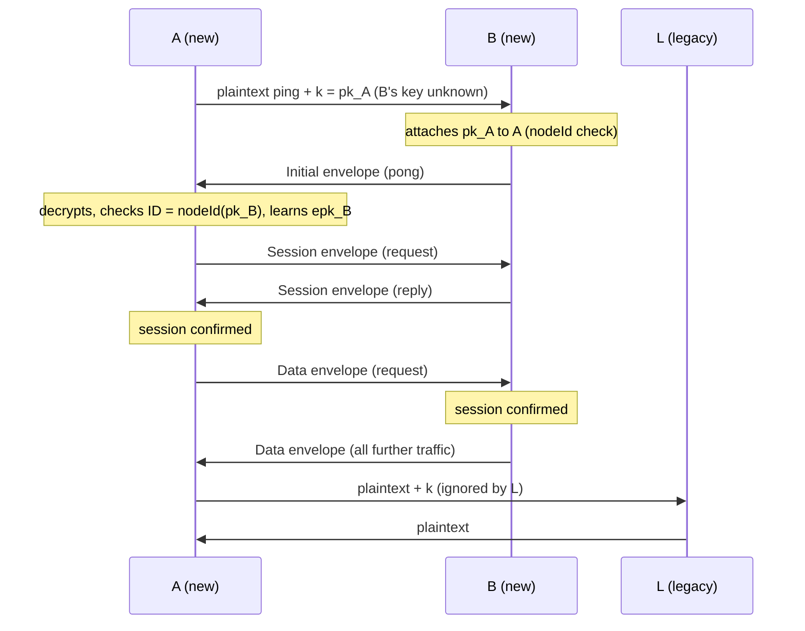
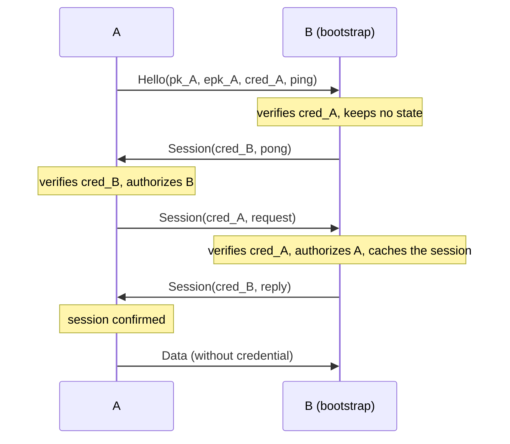

# Transport encryption: cryptographic design

This document specifies how OpenDHT encrypts and authenticates the UDP DHT protocol between nodes (the "transport"), and how private networks restrict participation with a small public-key infrastructure.

Implementation: [include/opendht/transport.h](../include/opendht/transport.h), [src/transport.cpp](../src/transport.cpp), and the send/receive paths in [src/network_engine.cpp](../src/network_engine.cpp).

## 1. Scope

### Goals

- **Confidentiality and integrity** of DHT protocol messages exchanged between two nodes that both support encryption.
- **Authenticated node IDs**: a node can only send encrypted messages under the node ID that derives from its own key.
- **Backward compatibility**: nodes without this feature keep working with new nodes, in plaintext.
- **Optional private networks**: when configured, a node only talks to nodes holding a credential signed by a trusted authority.
- **Forward secrecy**: recorded traffic stays confidential after a node's long-term key is compromised, once the ephemeral keys used for it are erased (at most one hour later). The first packet to a peer has weaker guarantees ([§5.2](#52-key-schedule)).
- **Address validation**: a Session or Data envelope proves that its sender receives packets at its source address. It replaces the legacy write tokens between encrypted nodes ([§6.6](#66-write-authorization)).
- **Low cost**: routing discovery also establishes the session, with a few X25519 operations per peer every 30 minutes. Once a session is established, 30 bytes of overhead per packet, minus the 40-byte token in messages that carried one.

### Non-goals

- **End-to-end protection of values.** Encryption is hop-by-hop. Nodes storing a value see it in clear. Use `SecureDht` (signed or encrypted values) for end-to-end protection. `SecureDht` identities are unrelated to transport keys.
- **Hiding metadata**: packet sizes, timing and addresses are visible, and so are the sender's public keys until a session is established.
- The REST proxy (`DhtProxyServer`/`DhtProxyClient`) and local peer discovery are not covered.

## 2. Notation

| Notation | Meaning |
|---|---|
| `a ‖ b` | Concatenation of byte strings |
| `"text"` | ASCII bytes, without terminator |
| `u32be(x)`, `u64be(x)` | Unsigned integer, big-endian, 4 or 8 bytes |
| `sk_A`, `pk_A` | Static transport secret and public key of node A |
| `esk_A`, `epk_A` | Ephemeral secret and public key of node A for the address of its peer |
| `DH(x, Y)` | `X25519(x, Y)` |
| `N` | Network ID (`Config::network`, 32-bit, `0` by default) |
| `K_A→B` | Key encrypting envelopes from A to B |

All keys are 32 bytes. Integers on the wire are big-endian.

## 3. Primitives

| Purpose | Primitive | Reference |
|---|---|---|
| Key agreement | X25519 | RFC 7748 |
| Key derivation | HKDF-SHA256 | RFC 5869 |
| Packet encryption | ChaCha20-Poly1305 AEAD, 96-bit nonce, 128-bit tag | RFC 8439 |
| Node ID | SHA-256, truncated to 160 bits | FIPS 180-4 |
| Credential signature | Ed25519 | RFC 8032 |
| Randomness | `gnutls_rnd` (`GNUTLS_RND_KEY` for keys, `GNUTLS_RND_NONCE` for nonces) | |

Primitives come from Nettle (libnettle and libhogweed) and GnuTLS, which OpenDHT already depends on. All primitives are used through their standard interfaces with no modification. The authentication tag is compared in constant time. Secret keys are erased with `gnutls_memset`.

## 4. Keys and identities

### 4.1 Transport key

Each node has a static X25519 key pair, its long-term identity:

```
sk = 32 random bytes
pk = X25519(sk, 9)
```

The key is either given in `Config::transport.key`, or generated on start. A generated key is saved in the node state when `Config::persist_path` is set (see [§8](#8-key-persistence)). Otherwise, it changes on every restart, and so does the node ID.

The transport key is used only for the transport. It is independent of the `SecureDht` identity (an RSA certificate).

### 4.2 Node ID

When transport encryption is enabled, the node ID is derived from the public key:

```
nodeId(pk) = SHA-256("opendht-node-id-v1" ‖ pk)[0..20)
```

`Config::node_id` is ignored in that case. This binding is what authenticates node IDs: a receiver checks that the ID claimed inside a decrypted message equals `nodeId(pk)` of the static key the envelope was authenticated with (see [§6.5](#65-receiving)). Holding the ID therefore requires holding `sk`.

When encryption is disabled (`TransportConfig::enabled = false`), the node uses the legacy behavior: a random ID, or `Config::node_id`.

### 4.3 Network authority (private networks)

An authority is an Ed25519 key pair. Its secret is the 32-byte Ed25519 seed. Its public key identifies the private network, and nodes are configured with a list of trusted authority public keys (`TransportConfig::authorities`). A network is private if and only if this list is non-empty.

### 4.4 Credential (private networks)

A credential is an authority's signature binding a transport public key to an expiration time. It is 105 bytes:

```
offset size field
0      1    version = 0x01
1      32   pk         transport public key of the node
33     8    expiry     u64be, seconds since the Unix epoch
41     64   signature  Ed25519 signature by the authority
```

The signature covers:

```
"opendht-credential-v1" ‖ 0x01 ‖ pk ‖ u64be(expiry)
```

A credential is **valid** at time `t` when both of these hold:
- `t < expiry`, using the verifier's system clock;
- the signature verifies under at least one trusted authority.

Credentials are not bound to a network ID. An authority key therefore defines a network: use distinct authorities for distinct networks.

## 5. Key agreement

### 5.1 Ephemeral keys

Each node has an epoch secret `S`: 32 random bytes, replaced every 30 minutes (an *epoch*). Its ephemeral key for a peer at address `addr` derives from it:

```
addr      = IP (4 bytes for IPv4, including IPv4-mapped IPv6, else 16 bytes) ‖ port (2 bytes, network order)
esk(addr) = HMAC-SHA256(key = S, "opendht-address-key-v1" ‖ addr)
epk(addr) = X25519(esk(addr), 9)
```

- The node always sends to `addr` with `epk(addr)` from its **current** epoch.
- It still accepts envelopes addressed to its key from the **previous** epoch, so peers have one epoch to learn the new key.
- On rotation, the previous epoch secret and every key derived from it are erased.

An ephemeral secret therefore lives at most one hour. Epoch secrets are never persisted, and a restart starts with a new one.

Nodes learn each other's ephemeral key from the header of every envelope ([§6.1](#61-envelope)). A node records a peer's ephemeral key only from an envelope it authenticated.

`epk(addr)` is only ever sent to `addr`. Learning it therefore requires receiving packets at `addr`, or observing the path to it. This is what makes a Session envelope a proof of address ([§6.6](#66-write-authorization)). Deriving keys per address costs one more X25519 base-point multiplication per new address, and nothing per packet.

### 5.2 Key schedule

Each envelope from a sender A to a receiver B is encrypted with a key `K_A→B`, derived with HKDF-SHA256 (RFC 5869):

```
prk     = HMAC-SHA256(key = "opendht-transport-v2", ikm)
K_A→B   = HMAC-SHA256(key = prk, info ‖ 0x01)
```

The input keying material `ikm` and `info` depend on what A knows about B.

**Session**: A knows B's ephemeral key `epk_B`:

```
ikm  = DH(esk_A, epk_B) ‖ DH(esk_A, pk_B) ‖ DH(sk_A, epk_B) ‖ DH(sk_A, pk_B)
info = u32be(N) ‖ 0x02 ‖ pk_A ‖ epk_A ‖ pk_B ‖ epk_B
```

**Initial**: A doesn't know B's ephemeral key, typically on first contact:

```
ikm  = DH(esk_A, pk_B) ‖ DH(sk_A, pk_B)
info = u32be(N) ‖ 0x01 ‖ pk_A ‖ epk_A ‖ pk_B
```

B computes the same values with its own secrets, since `DH(x_A, Y_B) = DH(y_B, X_A)`. Any DH result equal to zero (a low-order public key) is rejected.

Properties:

- **Directional keys.** `info` orders the keys as sender, then receiver, so `K_A→B ≠ K_B→A`. Each node derives both from the same four DH values.
- **Authentication.** Every key includes `DH(sk_A, pk_B)`, so only the holders of `sk_A` or `sk_B` can produce or read the envelope. Every envelope thus proves possession of the sender's static key.
- **Forward secrecy.** A Session key includes `DH(esk_A, epk_B)`. Once both ephemeral secrets are erased, the key cannot be recomputed, even with both static secrets.
- **Key-compromise impersonation resistance.** With `sk_B`, an attacker still cannot impersonate A to B in a Session envelope: it cannot compute `DH(sk_A, epk_B)` without `sk_A` or `esk_B`.
- **Initial keys are weaker**, as for the first message of Noise IK. Without `epk_B`, an Initial key is only forward-secret against a later compromise of `sk_A`, not of `sk_B`. It also allows impersonating A to B with `sk_B`. Initial envelopes are only sent until A learns `epk_B`, usually for a single packet.
- **Binding.** `info` includes `N`, the envelope type and all public keys involved. Nodes with different network IDs cannot decrypt each other's packets.
- **Cost.** A Session key costs four X25519 operations, plus one for our ephemeral key. It is cached in the epoch, so it is derived once per peer address and ephemeral key pair, once the peer has proven to receive at that address ([§6.5](#65-receiving)). An Initial key costs two X25519 operations, plus one for our ephemeral key, and is not cached. Each epoch caches at most 16384 sessions, evicting the least recently used; beyond that, keys are derived for each packet.

## 6. Wire protocol

### 6.1 Envelope

Initial and Session envelopes carry the sender keys:

```
offset size        field
0      1           marker = 0xC1
1      1           type: 1 = Initial, 2 = Session, 3 = Hello; | 0x80 if a credential is included
2      32          pk_sender
34     32          epk_sender
66     12          nonce (random)
78     len         ciphertext
78+len 16          Poly1305 tag
```

Once the session is confirmed ([§6.4](#64-sending)), Data envelopes leave them out. The receiver finds the session keys from the source address:

```
offset size        field
0      1           marker = 0xC1
1      1           type = 4 (Data), never with a credential
2      12          nonce (random)
14     len         ciphertext
14+len 16          Poly1305 tag
```

- The ciphertext is `ChaCha20-Poly1305(K_sender→receiver, nonce, plaintext, aad = header)`.
- The header is bytes `[0, 66)`, or `[0, 2)` for Data: marker, type, and the sender keys. Because it is the associated data, an attacker cannot change the type, the credential flag or the sender keys without the tag check failing.
- The plaintext is the msgpack-encoded DHT message. With the credential flag, it is preceded by the sender's 105-byte credential.
- The overhead is 30 bytes for Data, 94 bytes for Initial and Session, or 199 bytes with a credential.
- Nonces are 96 bits from the system CSPRNG. For `n` packets under one key, the probability of a nonce collision is about $n^2 / 2^{97}$. Keys change at least every epoch, so this is negligible.

`0xC1` is the one byte value that msgpack never uses. Every legacy OpenDHT message is a msgpack map, which starts with `0x80`–`0x8F` or `0xDE`–`0xDF`. This marker therefore unambiguously separates envelopes from plaintext messages:
- legacy nodes fail to parse an envelope and drop it, without blacklisting the sender;
- new nodes still parse plaintext messages normally.

### 6.2 Hello (private networks only)

`Hello` introduces a node to a peer whose key is unknown. This happens when pinging a bare address, typically a bootstrap node. A Hello is **not encrypted**:

```
0xC1 ‖ 0x03 ‖ pk_sender ‖ epk_sender ‖ credential (105 bytes) ‖ msgpack ping
```

The sender cannot encrypt to a key it doesn't know, and X25519 keys cannot sign, so **a Hello proves nothing about its sender**. Its credential travels in clear and can be copied. The receiver therefore:

- answers only a ping, and only if the credential is valid for `pk_sender`;
- answers with a Session envelope to `pk_sender` and `epk_sender`, so only the holder of `sk_sender` can read the answer;
- keeps no state from the Hello: it does not add, move or authorize the claimed node.

The sender proves possession of its key with its next envelope.

### 6.3 Key advertisement in plaintext messages

New nodes add fields to plaintext msgpack messages. Legacy nodes ignore unknown fields.

| Field | Location | Content |
|---|---|---|
| `k` | top level | Sender's transport public key (bin, 32 bytes) |
| `k4` | reply body, next to `n4` | Concatenated public keys of the listed IPv4 nodes, 32 bytes per node, all-zero if unknown |
| `k6` | reply body, next to `n6` | Same for IPv6 |

Rules for using these fields:

- **`k` is sent only when it is needed**: in public mode, in plaintext messages to nodes whose key is not yet known. Encrypted messages do not need it, because the sender key is in the envelope header.
- **Listed keys are checked before use.** A key from `k`, `k4` or `k6` is attached to a node only if `nodeId(key)` equals the node's ID. Otherwise it is ignored.
- **The binding limits what a dishonest node can do with a node list.** It cannot attach a forged key to an existing node ID. It can still list a wrong address, which at worst causes encrypted packets to be sent to the wrong host. That host cannot read them.
- `k4` and `k6` are omitted if no listed node has a known key. They are ignored if their length is not exactly 32 × the number of listed nodes.

### 6.4 Sending

To send a message to node B:

1. If transport encryption is disabled, send plaintext.
2. If B's static key is known (B has a peer record), send an envelope with our ephemeral key for B's address:
   - a Data envelope if our session with B's address is **confirmed**;
   - otherwise a Session envelope if B's ephemeral key is known, or else an Initial envelope. In a private network, both include our credential.
3. Else, in a private network:
   - if B's ID is unknown (a ping to a bare address), send a `Hello`;
   - otherwise refuse to send (`EPERM`).
4. Else (public network, key unknown), send plaintext, including `k`.

Once a node's key is known, nothing is ever sent to it in plaintext. Failed key agreement, including a low-order public key, refuses the send (`EPERM`); it never falls back to plaintext.

**Confirmation.** A session with an address is confirmed when B shows that it holds the session keys and accepted us:
- B answers, in a Session or Data envelope, a request we sent to its node ID **in a Session or Data envelope**. B cached the session when it opened our envelope ([§6.5](#65-receiving)), and answered with keys of our current epoch. Requests sent in an Initial envelope or a Hello are excluded: B answered them without caching a session, so our next request is a Session envelope, and its answer confirms;
- or we receive a Data envelope under our current epoch. B only sends one after we confirmed it the same way.

The confirmation is lost when the session keys change: on epoch rotation, or when B's ephemeral key changes through accepted traffic. An Initial request leaves existing state untouched and is answered without reusing a cached session or its confirmation.

**Establishment.** Only `ping` and `find_node` requests may precede address validation. Application requests wait until B's ephemeral key is known, or a successful control reply identifies a genuinely keyless legacy peer. Learning the ephemeral from an accepted Initial reply is enough to send a Session: neither address-indexed cache admission nor Data confirmation requires another handshake. Direct NetworkEngine application requests share one engine-owned ping; canceling a caller's ping cannot strand them. Private bare-address bootstrap remains a ping-only Hello.

**Recovery.** At the first response timeout, a request forgets B's ephemeral key and starts recovering the session, for example after B restarts. Application requests to B are withheld, including new requests, while one internal ping retries in Initial envelopes (with our credential in a private network). `find_node` remains available and its successful reply can also release the waiters. An accepted reply completes its own request before held work is released, so a delayed original reply is not retransmitted during attachment. Released requests receive fresh response timers; withholding consumes no transmission attempts. The internal probe's first timeout notifies waiting operations so searches can replace unresponsive peers promptly. Probe exhaustion or rejection terminates the waiters. Their payloads never enter Initial envelopes, and no `401` challenge/retry exchange is used.

**Value searches.** A cold peer first receives `find_node(search_target)`. Its reply supplies its ephemeral and closer candidates in the same exchange. The existing distance-ordered search dispatch contacts closer candidates immediately, within the existing four-active-peer limit; it does not wait for a SELECT reply from the farther responder. This routing probe has separate state: it cannot satisfy a GET, pagination, or an empty-result callback. Responders remain eligible for subsequent value retrieval. A cold holder typically needs three exchanges (`find_node`, SELECT IDs, GET by ID), while a session-ready holder retains its usual two. A routing probe's first timeout frees its active search slot while protocol retries continue, rather than waiting for final expiration.

Value data is fragmented so that each packet fits in the 1280-byte IPv6 minimum MTU: `1280 − 40 − 8 = 1232` bytes of UDP payload, less 48 bytes reserved for the msgpack framing of a fragment, less the overhead of the envelope the fragments are sent in. Fragments carry `1184` bytes of value data in plaintext, `1154` in Data envelopes, `1090` in Initial or Session envelopes, and `985` with a credential.

This sizes value fragments only. Complete replies and node lists are not yet subject to a whole-datagram MTU budget; node-list trimming and packet-size enforcement remain separate work.

### 6.5 Receiving

For each received packet, a node applies the following checks in order:

1. **Address filters.** Drop the packet if it comes from a martian or blacklisted address. This is unchanged.

2. **Envelopes.** If the packet starts with `0xC1`:
   1. If encryption is disabled, drop it.
   2. Drop it if its type is unknown, or if `pk_sender` is our own key. This rejects reflected packets.
   3. **Hello:**
      - Drop it outside private networks, or if it carries no message.
      - Apply the public-key limit, then verify the credential: its key must equal `pk_sender` and it must be valid. Drop the packet on failure.
      - Continue with steps 4 and 5, then answer as described in [§6.2](#62-hello-private-networks-only). The Hello is not processed any further.
   4. **Initial:** apply the public-key limit, derive the Initial key from `pk_sender` and `epk_sender`, and decrypt.
  5. **Session:** first try the keys cached in each epoch for (source address, `pk_sender`, `epk_sender`). Otherwise, apply the public-key limit, then for our current epoch then the previous one: derive the keys with our ephemeral key for the source address, and decrypt. Keep newly derived keys pending until the packet passes authorization and message validation.
   6. **Data:** decrypt with the session cached for the source address in our current epoch, then in the previous one. Its `pk_sender` and `epk_sender` are those of the session. This needs no key derivation and no public-key limit.
   7. Drop the packet if it was not decrypted.
   8. **Credential flag:** strip the 105-byte credential. In a private network, verify it as for Hello, unless the peer is already authorized; on success, the peer is authorized until the credential expires.
      **No credential:** in a private network, drop the packet unless the peer is currently authorized.
  9. Record `epk_sender` on a temporary peer record. It is **validated for the source address** if the envelope was a Session or Data envelope: opening it required our ephemeral key for that address, which was only ever sent there. Existing peer state is updated only after parsing, ID binding and the processing checks below.

  **Session cache.** The epoch caches one session per source address. Newly derived Session keys enter the cache only after credential authorization, parsing, network and node ID checks, and basic fragment validation. Replies must match a pending request or listener. Admission is per packet, so subsequent Data fragments can decrypt before the whole message is assembled. Sending to the exact address for which the peer's ephemeral key is validated can also cache a session. Answers to Initial and Hello envelopes never use or change cached sessions: their source address may be spoofed.

3. **Plaintext in a private network.** Drop any packet that is not an envelope.

4. **Parsing.** Parse the msgpack message and apply the network ID check. This is unchanged.

5. **Envelope ID binding.** For an envelope, the message's node ID must equal `nodeId(pk_sender)`, otherwise drop the message. Value data fragments are exempt because they carry no node ID. Fragment buffers are keyed by source address, transaction ID and sender key, with a separate keyless buffer for plaintext. Only parts from the same sender can join a header, and a response header must match a pending request or listener. Foreign-key or plaintext parts cannot reserve the expected sender's buffer, even when they arrive first. Initial envelopes carrying value fragments or fragmented-message headers are dropped: encrypted value data requires a Session or Data envelope.

6. **Plaintext with `k`.** For a plaintext message carrying `k`, attach the key to the sender if it matches the sender's ID.

7. **Processing.**
  - A Session or Data envelope can move the sender's node record to the packet's source address.
  - Initial requests use transient node records. Only `ping` and `find_node` receive successful replies; GET (including SELECT) and writes receive a short `401` error, and value updates are dropped. Rejected GETs never invoke storage or serialize values. These requests do not add or move an established node, count as activity, or change its ephemeral key or session confirmation.
  - Initial replies and errors are accepted only for a pending request at the expected source address, never for a listener. They cannot move a known keyed node to a different address.
   - Replies and Data envelopes can confirm the session ([§6.4](#64-sending)).

  A **plaintext** message claiming the ID of a node whose key is known is untrusted, even from that node's recorded address:
   - it does not move the node record and does not count as activity from that node;
  - replies, errors, value updates and writes are dropped;
  - `ping` and `find_node` receive control replies using a transient node record and an Initial envelope to the known key; GET receives a short `401`, even when the plaintext packet is the first advertisement of a matching `k`. Truly keyless legacy GETs remain unchanged.

**Rate limits.** A node keeps separate budgets, each with a global quota and a quota per source address (per /64 prefix for IPv6):
- **Session requests:** requests in Session or Data envelopes, whose source address is validated. `Config::max_req_per_sec`, by default 8192 per second, and 1024 per address.
- **Other requests:** plaintext requests and requests in Initial or Hello envelopes, whose source address can be spoofed. `Config::max_unauth_req_per_sec`, with the same defaults. A flood of them does not affect requests from established peers.
- **Public-key work:** one unit per packet needing a key agreement or a signature verification, charged before that work. `Config::max_crypto_per_sec`, by default 512 per second, and 64 per address. A unit covers the packet and its answer, including credential verification:
  - each Initial envelope (two X25519 operations, and five more to answer a request);
  - each Session envelope from an uncached (address, `pk_sender`, `epk_sender`) triple (five X25519 operations per epoch tried);
  - each Hello (one Ed25519 verification, and the key derivation of its answer);
  - each plaintext request from a sender whose key is known or advertised, answered in an Initial envelope (three X25519 operations).

  Initial and uncached Session envelopes from an address where we await an answer, from the sender's node record or from a request sent by address, use a separate budget of the same size. Our own key exchanges thus complete during a flood.

Packets from peers with cached session keys cost one AEAD operation. Each epoch caches at most 16384 sessions, evicting the least recently used one to store a new one. An evicted peer recovers after one retransmission. Only a peer that received a packet from us at its address can take a cache slot, so a slot costs the attacker a reachable address and a round trip.

### 6.6 Write authorization

`put`, `refresh` and `listen` create state on the receiver, and `listen` makes it send value updates to the requester's address. The receiver therefore requires proof that the requester receives packets at its source address. Without it, an attacker could spoof a victim's address to fill its storage quota, or direct update traffic to it.

- **Encrypted requests** must arrive in a **Session** or **Data** envelope. Our ephemeral key for the source address is only sent to that address ([§5.1](#51-ephemeral-keys)), so opening the envelope proves the sender received one of our packets there. Requests in Initial envelopes are refused with error `401`; normal senders establish the session through `ping` or `find_node` before sending application requests.
- **Plaintext requests** must carry a token, as in the legacy protocol. The token is sent in answers to `find`, `get` and `listen`, and in value updates, to the address of the node record:

  ```
  token(addr) = HMAC-SHA256(key = S, "opendht-address-token-v1" ‖ addr)
  ```

  A token is accepted in the epoch it was issued and the next one. Legacy nodes treat tokens as opaque, so changing their derivation keeps compatibility.

Messages to and from encrypted nodes carry no token. This saves 40 bytes in each answer to `find`, `get` and `listen`, and in each `put`, `refresh`, `listen` and value update. A node that receives an encrypted answer may write to its sender.

## 7. Message flows

### 7.1 Public network

Encryption is opportunistic, and keys travel with node IDs.



- The first request to a node with an unknown key, typically a bootstrap ping, is in plaintext. Its reply is an Initial envelope. The next request and its reply use Session envelopes, and all later traffic uses Data envelopes.
- Nodes learned through `k4`/`k6` get an Initial envelope as the first packet. Its answer is a Session envelope, but the answerer caches nothing yet: the next request is a Session envelope, and its answer confirms the session. Data envelopes follow.
- Legacy nodes see plaintext from new nodes and are unaffected.

### 7.2 Private network

Only nodes with a credential participate. Nodes never send or accept plaintext.



- **Credential exchange.** Each side attaches its credential to its Initial and Session envelopes. Data envelopes, sent once the peer has accepted us, never carry it.
- **Authorization lifetime.** A peer stays authorized until its credential expires, according to the local clock. After that, its packets without a credential are dropped.
- **Node lists.** Listed nodes without a valid matching key are discarded.
- **Startup checks.** The node refuses to start (`DhtException`) if:
  - encryption is disabled while authorities are configured;
  - the configured credential does not match the transport key;
  - the credential is not valid for the configured authorities.

  A warning is logged if the credential expires within a week. The credential is read once on start, so renewing it requires a restart.

## 8. Key persistence

If the following conditions all hold, the static secret key is saved in the state file as the msgpack field `transport_key` (32 bytes):
- encryption is enabled;
- no key was configured;
- `Config::persist_path` is set.

When the key is saved:
- the state is written to a randomly named temporary file in the destination directory;
- owner-only read/write permissions are requested before any secret data is written;
- the temporary file is closed successfully before it is renamed over the state file;
- a save failure is logged, the temporary file is removed, and the previous state file is left intact;
- on start, the key is restored before any packet is exchanged, so the node keeps its ID across restarts.

The node also stores its ID in the state file, so older versions reading this state keep the same ID. A configured key is never written to the state file. Ephemeral keys and session keys are never persisted.

`dhtnode --transport-key <file>` loads the raw 32-byte secret from `<file>`. If the file does not exist, `dhtnode` creates it using the same temporary-file and permission handling. Unreadable or invalid existing keys are not replaced.

File operations use portable C++ filesystem APIs. Permission semantics depend on the platform; exclusive file creation and power-loss durability are not guaranteed. Use an owner-controlled directory and a single writer for each path.

## 9. Security analysis

### 9.1 Properties

Against an attacker who controls the network but holds no node's secret key:

- **Confidentiality and integrity.** Traffic between two nodes that know each other's keys is confidential and integrity-protected. The protection is IND-CCA2 and INT-CTXT, from ChaCha20-Poly1305 under keys derived from X25519.
- **ID authentication.** An encrypted message under node ID `X` can only be produced by the holder of the static secret key behind `X`.
  - Producing a key for a given ID requires a SHA-256 preimage on 160 bits.
  - Choosing the first `b` bits of one's own ID costs about $2^b$ key generations. Legacy nodes choose their ID freely.
- **Forward secrecy.** Session envelopes recorded by the attacker stay confidential if static keys are compromised later, once both ephemeral secrets are erased (at most one hour after use). Initial envelopes stay confidential if the sender's static key is compromised, but not the receiver's.
- **Key-compromise impersonation.** With a node's static secret, an attacker can decrypt the Initial envelopes sent to it and impersonate other nodes to it in Initial envelopes, but not in Session envelopes.
- **Address stickiness.** Spoofed plaintext, Hellos and replayed Initial envelopes cannot redirect a node record whose key is known. Moving it requires a Session or Data envelope from the new address (see [§6.2](#62-hello-private-networks-only) and [§6.5](#65-receiving)).
- **Fragment integrity.** Once a fragmented message arrives in envelopes, only parts from the same sender key are merged. Spoofed plaintext or foreign-key parts cannot alter or block it ([§6.5](#65-receiving), step 5).
- **Address validation.** Session and Data envelopes only open from the address our ephemeral key was sent to. An off-path attacker cannot send one from a spoofed address, even with its own valid static key, so it cannot `put`, `refresh` or `listen` on behalf of another address.
- **Private-network admission.** Without a valid credential and its matching secret key, a node:
  - cannot read any traffic;
  - cannot get answers it can decrypt;
  - is never listed by honest nodes.
- **Network separation.** Different network IDs derive different keys.
- **DoS cost.** An unauthenticated Data envelope costs a lookup and at most two AEAD operations. Other envelopes pass the public-key limit before any key derivation or signature verification.

### 9.2 Limitations

Each item states who it applies to, what that party can do, and what it cannot do.

- **Encryption is hop-by-hop.** Nodes that store values read them. Only `SecureDht` protects values end to end ([§1](#1-scope)).

- **Public mode is trust on first use.** Applies in public networks, to an attacker who modifies traffic on the path between two nodes A and B before A knows B's key.
  - A node learns a peer's key from the first plaintext message that carries it with the peer's ID: `k` in a message from the peer, or `k4`/`k6` in a reply from any node. An attacker that removes these fields from every such message keeps A and B in plaintext, and reads and modifies their traffic. The downgrade ends with the first message carrying a key that the attacker misses: the node that receives it then sends only envelopes to that peer, which the attacker cannot alter, and treats plaintext claiming the peer's ID as untrusted ([§6.5](#65-receiving), step 7). The attacker can still drop their traffic.
  - The attacker cannot bind its own key to B's ID. It can rewrite B's plaintext messages under an ID and key of its own, so that A talks to the attacker's node at B's address, and the attacker relays to B. A then knows the attacker's node at that address, not B.
  - Until A knows a key for an ID, any plaintext sender can claim that ID from any address. The claim lasts until A learns the key: plaintext claiming the ID is untrusted from then on, and the first Session or Data envelope under it moves the node record to its sender's address.
  - A key received in an encrypted reply cannot be stripped. One received in a plaintext reply can, by an attacker on that reply's path.
  - The first request to a node with an unknown key, for example a bootstrap ping, is in plaintext.
  - Private networks are not affected: they never send or accept plaintext, and credentials authenticate keys.

- **Compromise of a static secret key.** Applies to whoever obtains `sk_B`, for example from B's key file or state file, for as long as B keeps that key.
  - It can act as B from any address, and talk to any node under B's ID.
  - It can read every Initial envelope ever sent to B, including recorded ones. Initial keys depend only on `sk_B` and the sender's public keys.
  - It can send Initial envelopes to B under any other node's ID. B answers `ping` and `find_node` in them, under keys the attacker cannot derive, and changes no state ([§6.5](#65-receiving), step 7). GET and writes are refused with `401`.
  - It cannot read Session or Data envelopes between B and other nodes, recorded or live, nor impersonate another node to B in them. That requires B's ephemeral secret, or the other node's static secret.
  - In a private network, it stays admitted until B's credential expires. The credential is not secret: Hellos carry it in clear.
  - Compromise of a running node also exposes its epoch secrets, and with them all sessions of its current and previous epoch.

  Recover by changing the key. This changes the node ID, and in a private network needs a new credential. The old key cannot be revoked in a public network.

- **Initial envelopes are not forward-secret against the receiver.** An Initial envelope stays confidential if the sender's static key is compromised later, but not if the receiver's is. Initial envelopes carry:
  - `ping` or `find_node` to a node whose ephemeral key is unknown, including their retransmissions;
  - control replies to plaintext requests advertising a key. Application requests wait for a Session ([§6.4](#64-sending)).

  Routing targets and control traffic remain exposed to a later compromise of the receiver's static key. Application GET/SELECT and write payloads do not enter Initial envelopes. Answers to Initial envelopes are Session envelopes, and are forward-secret.

- **No replay protection.** Nodes keep no record of received nonces. A captured envelope is accepted again as long as the receiver holds the keys that open it:
  - **Initial envelopes** open from any address, for as long as the receiver's static key is unchanged. A replayed `ping` or `find_node` is answered again, to the replayer's source address, under keys the replayer cannot derive. GET and writes are refused with `401`, value updates are dropped, and replies and errors are accepted only for a request pending toward that address ([§6.5](#65-receiving), step 7). Reflection remains for control replies: anyone holding a captured Initial request, or a Hello, can make the receiver send an encrypted answer to an address of its choice. In a private network this includes outsiders, because the captured packet carries its sender's credential. Rate limits bound request frequency, not reply size; node-list packet-size limits remain separate work.
  - **Session and Data envelopes** open only from their original source address, which the replayer must spoof, and only until the epoch that opened them is erased: at most one hour. A replayed request is processed again as its sender, including a write the sender did make: a repeated `put`, `refresh` or `listen` extends the life of a value or of a listener. A replayed value update is accepted while its listen is open, and repeats it: the values it lists are added or refreshed again, and the expirations it announces are signaled again. A replayed reply or error is accepted only if its transaction ID is pending. Transaction IDs are 32-bit counters per peer with a random start, so an old ID is pending again only after $2^{32}$ requests to that peer.

- **On-path attackers get write authorization for the addresses they observe.** Applies to an attacker that reads the packets we send to an address `addr`. Our ephemeral key `epk(addr)` is in the clear header of every Initial and Session envelope we send there: at each first contact, retransmission and epoch rotation. Data envelopes do not carry it.
  - With its own key pair, the attacker can send us Session envelopes with source address `addr`, and they open. It then has what the owner of `addr` has: write authorization ([§6.6](#66-write-authorization)). Its `put` and `refresh` consume the storage quota of `addr`, and its `listen` directs value updates to `addr`, all under the attacker's own node ID. Each such envelope also replaces the session cached for `addr`, so Data envelopes from the real owner are dropped until its next retransmission establishes a new session ([§6.4](#64-sending), recovery).
  - It cannot impersonate the node at `addr`, nor read or alter its traffic. That requires the static secret of that node.
  - A captured `epk(addr)` is usable until the epoch that produced it is erased: at most one hour.
  - In a private network, the attacker's key must also hold a valid credential.

  This is the same exposure as legacy tokens, which are sent in clear to the address they authorize. Address validation defends against off-path spoofing only.

- **Address changes.** Our ephemeral key for a peer is derived from its address. When a peer's address or port changes, for example after a NAT rebinding, its Session and Data envelopes to us no longer open, and ours no longer reach it. Its next retransmission is a ping in an Initial envelope, which starts a new session for the new address, and the request follows in a Session envelope ([§6.4](#64-sending), recovery).

- **No Sybil resistance.** An identity costs one key generation. Encryption prevents choosing a node ID ([§9.1](#91-properties)), not creating many of them. In public networks, legacy nodes still choose their IDs freely.

- **Denial of service.** Public-key operations on unauthenticated packets are bounded by the public-key limit ([§6.5](#65-receiving)): by default 512 packets per second globally, and 64 per source address or IPv6 /64 prefix.
  - An attacker spending that budget from many or spoofed addresses drops Initial, Hello and uncached Session envelopes from new peers, and plaintext requests from keyed senders. Answers to our own requests have a separate budget, which only an attacker spoofing the addresses of the peers we contact can spend. Data envelopes, cached sessions and requests from established peers are unaffected.
  - Likewise, a flood of plaintext or Initial requests drops other requests without a session, as in the legacy protocol, but not those of established peers.
  - A unit stands for three to ten X25519 operations, so the default allows about 5000 per second. `Config::max_crypto_per_sec` adapts it to the CPU available.
  - An attacker reachable at many addresses, for example an IPv6 prefix, can fill the session cache of an epoch: one slot costs it one round trip. Evicted peers have their Data envelopes dropped until their next retransmission, which starts a new session.

- **No revocation.** Applies to private networks. A credential cannot be revoked before it expires. A peer that presented a valid credential stays authorized until that credential's expiry, so a compromised or excluded node keeps participating until then. To exclude it earlier, every other node must stop trusting the authority that signed its credential. That also excludes every other node that only holds credentials from that authority. Keep validity periods short.

- **Clock dependence.** Applies to private networks. Credential expiry is checked against each verifier's system clock. A verifier whose clock is behind keeps accepting an expired credential for as long as it is behind; one whose clock is ahead rejects a valid credential early. A node checks its own credential the same way at startup.

- **Metadata.** Anyone observing the traffic sees:
  - in Initial and Session envelopes, the sender's static key, hence its node ID, and its ephemeral key: who talks to whom, at each first contact, retransmission and epoch rotation;
  - in Data envelopes, only the type; the sender is still identified by its address, from the Session envelopes that preceded;
  - in every envelope, the type, the credential flag, the size and the timing, which can reveal the kind of message, for example fragmented value data;
  - Hello messages entirely, including the credential, which reveals the node's key and the credential's expiry. A copied credential is useless without the matching secret key;
  - in public networks, plaintext messages entirely, including node lists.

  Node addresses are not hidden: they are in node lists, and on the packets themselves.

- **Node state.** The saved node list holds IDs and addresses, but no keys. In a public network, saved nodes are contacted again in plaintext, with the first-contact exposure above. In a private network, a saved node with an ID but no key cannot be contacted ([§6.4](#64-sending), step 3): a restarted node needs a bootstrap address to rejoin, and reuses saved nodes once it learns their keys from node lists.

## 10. Operating a private network

With `dhtnode`:

```sh
# Once: create the authority (net.key = secret seed, net.pub = hex public key)
dhtnode --gen-network-authority net

# For each node: create its transport key, and a credential valid for 90 days
dhtnode --transport-key node1.key --issue-credential node1.cred --authority-key net.key --validity 90

# Run a node
dhtnode --transport-key node1.key --network-credential node1.cred --network-authority $(cat net.pub)
```

Authority generation refuses to run if either output path already exists, including a dangling symlink.

`--network-authority` can be repeated to trust several authorities, for example during an authority rotation. Keep the authority secret offline. Distribute only `net.pub` and the per-node credentials.

From the library, set `Config::transport` before starting:
- `authorities`;
- `key`, which must be the key the credential was issued for;
- `credential`.

## 11. Constants

| Name | Value |
|---|---|
| Envelope marker | `0xC1` |
| Envelope types | `Initial = 1`, `Session = 2`, `Hello = 3`, `Data = 4` |
| Credential flag | `0x80` |
| Key, nonce, tag sizes | 32, 12, 16 bytes |
| Envelope header | 66 bytes, 2 for Data |
| Envelope overhead | 30 bytes for Data, 94 for Initial and Session (199 with credential) |
| Epoch (ephemeral keys and tokens) | 30 minutes, previous epoch accepted for one more period |
| Cached sessions per epoch | 16384, least recently used evicted |
| Credential size, version | 105 bytes, `0x01` |
| Node ID context | `"opendht-node-id-v1"` |
| HKDF salt | `"opendht-transport-v2"` |
| Credential signature context | `"opendht-credential-v1"` |
| Ephemeral key, token contexts | `"opendht-address-key-v1"`, `"opendht-address-token-v1"` |
| Token size | 32 bytes |
| Value fragment size | 1184 bytes, less the envelope overhead (1154 to 985) |
