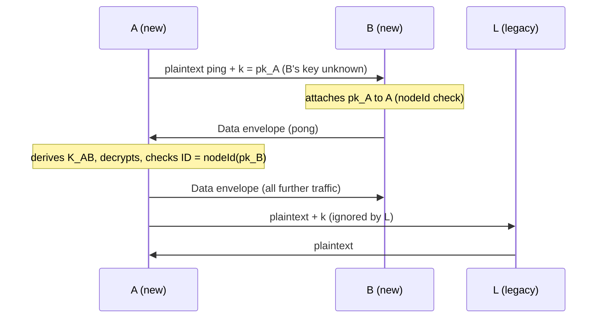
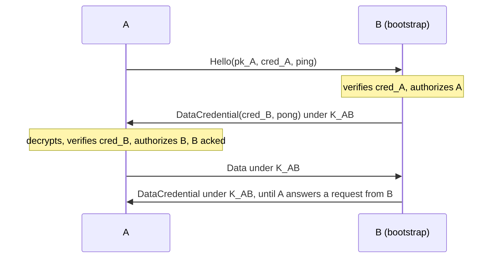

# Transport encryption: cryptographic design

This document specifies how OpenDHT encrypts and authenticates the UDP DHT protocol between nodes (the "transport"), and how private networks restrict participation with a small public-key infrastructure.

Implementation: [include/opendht/transport.h](../include/opendht/transport.h), [src/transport.cpp](../src/transport.cpp), and the send/receive paths in [src/network_engine.cpp](../src/network_engine.cpp).

## 1. Scope

### Goals

- **Confidentiality and integrity** of DHT protocol messages exchanged between two nodes that both support encryption.
- **Authenticated node IDs**: a node can only send encrypted messages under the node ID that derives from its own key.
- **Backward compatibility**: nodes without this feature keep working with new nodes, in plaintext.
- **Optional private networks**: when configured, a node only talks to nodes holding a credential signed by a trusted authority.
- **Low cost**: no handshake round trip, one Diffie-Hellman per peer, 62 bytes of overhead per packet.

### Non-goals

- **End-to-end protection of values.** Encryption is hop-by-hop. Nodes storing a value see it in clear. Use `SecureDht` (signed or encrypted values) for end-to-end protection. `SecureDht` identities are unrelated to transport keys.
- **Forward secrecy** (see [§9.2](#92-limitations)).
- **Hiding metadata**: packet sizes, timing, addresses and the sender's public key are visible.
- The REST proxy (`DhtProxyServer`/`DhtProxyClient`) and local peer discovery are not covered.

## 2. Notation

| Notation | Meaning |
|---|---|
| `a ‖ b` | Concatenation of byte strings |
| `"text"` | ASCII bytes, without terminator |
| `u32be(x)`, `u64be(x)` | Unsigned integer, big-endian, 4 or 8 bytes |
| `sk_A`, `pk_A` | Transport secret and public key of node A (32 bytes each) |
| `N` | Network ID (`Config::network`, 32-bit, `0` by default) |
| `K_AB` | Symmetric key shared by A and B |

All keys are 32 bytes. Integers on the wire are big-endian.

## 3. Primitives

| Purpose | Primitive | Reference |
|---|---|---|
| Key agreement | X25519 | RFC 7748 |
| Key derivation | HKDF-SHA256 | RFC 5869 |
| Packet encryption | ChaCha20-Poly1305 AEAD, 96-bit nonce, 128-bit tag | RFC 8439 |
| Node ID | SHA-256, truncated to 160 bits | FIPS 180-4 |
| Credential signature | Ed25519 | RFC 8032 |
| Randomness | `gnutls_rnd` (`GNUTLS_RND_KEY` for keys, `GNUTLS_RND_NONCE` for nonces) | |

Primitives come from Nettle (libnettle and libhogweed) and GnuTLS, which OpenDHT already depends on. All primitives are used through their standard interfaces with no modification. The authentication tag is compared in constant time.

## 4. Keys and identities

### 4.1 Transport key

Each node has a static X25519 key pair:

```
sk = 32 random bytes
pk = X25519(sk, 9)
```

The key is either given in `Config::transport.key`, or generated on start. A generated key is saved in the node state when `Config::persist_path` is set (see [§8](#8-key-persistence)). Otherwise, it changes on every restart, and so does the node ID.

The transport key is used only for the transport. It is independent of the `SecureDht` identity (an RSA certificate).

### 4.2 Node ID

When transport encryption is enabled, the node ID is derived from the public key:

```
nodeId(pk) = SHA-256("opendht-node-id-v1" ‖ pk)[0..20)
```

`Config::node_id` is ignored in that case. This binding is what authenticates node IDs: a receiver checks that the ID claimed inside a decrypted message equals `nodeId(pk)` of the key that decrypted it (see [§6.5](#65-receiving)). Holding the ID therefore requires holding `sk`.

When encryption is disabled (`TransportConfig::enabled = false`), the node uses the legacy behavior: a random ID, or `Config::node_id`.

### 4.3 Network authority (private networks)

An authority is an Ed25519 key pair. Its secret is the 32-byte Ed25519 seed. Its public key identifies the private network, and nodes are configured with a list of trusted authority public keys (`TransportConfig::authorities`). A network is private if and only if this list is non-empty.

### 4.4 Credential (private networks)

A credential is an authority's signature binding a transport public key to an expiration time. It is 105 bytes:

```
offset size field
0      1    version = 0x01
1      32   pk         transport public key of the node
33     8    expiry     u64be, seconds since the Unix epoch
41     64   signature  Ed25519 signature by the authority
```

The signature covers:

```
"opendht-credential-v1" ‖ 0x01 ‖ pk ‖ u64be(expiry)
```

A credential is **valid** at time `t` when both of these hold:
- `t < expiry`, using the verifier's system clock;
- the signature verifies under at least one trusted authority.

Credentials are not bound to a network ID. An authority key therefore defines a network: use distinct authorities for distinct networks.

## 5. Key agreement

Two nodes A and B derive their shared key without exchanging messages, from their static keys and the network ID:

```
dh   = X25519(sk_A, pk_B)            (= X25519(sk_B, pk_A))
     reject if dh is all zeros       (low-order peer key)
prk  = HMAC-SHA256(key = "opendht-transport-v1", dh)
info = u32be(N) ‖ min(pk_A, pk_B) ‖ max(pk_A, pk_B)
K_AB = HMAC-SHA256(key = prk, info ‖ 0x01)
```

This is HKDF-SHA256 (RFC 5869):
- the salt is `"opendht-transport-v1"`;
- the input keying material is `dh`;
- `info` is as above;
- the output is 32 bytes.

The `min` and `max` are lexicographic byte comparisons, so both sides compute the same `info`.

Properties:

- `K_AB` is the same in both directions, and nonces are random (see [§6.1](#61-envelope)), so the two directions cannot collide by construction.
- Including `N` separates networks. Nodes with different network IDs derive different keys and cannot decrypt each other's packets.
- Including both public keys binds the key to the pair of identities.
- A node caches `K_AB` on its in-memory record of the peer, so X25519 runs once per peer, not once per packet.

## 6. Wire protocol

### 6.1 Envelope

Encrypted packets use this format:

```
offset size        field
0      1           marker = 0xC1
1      1           type: 1 = Data, 2 = DataCredential, 3 = Hello
2      32          pk_sender
34     12          nonce (random)
46     len         ciphertext
46+len 16          Poly1305 tag
```

- The ciphertext is `ChaCha20-Poly1305(K, nonce, plaintext, aad = header)`.
- The header is bytes `[0, 34)`: marker, type and sender key. Because it is the associated data, an attacker cannot change the envelope type or the sender key without the tag check failing.
- The plaintext is:
  - for `Data`: the msgpack-encoded DHT message;
  - for `DataCredential`: the sender's 105-byte credential followed by the msgpack message.
- The overhead is 62 bytes for `Data` and 167 bytes for `DataCredential`.
- Nonces are 96 bits from the system CSPRNG. For `n` packets under one key, the probability of a nonce collision is about $n^2 / 2^{97}$. This is negligible for the traffic between two DHT nodes.

`0xC1` is the one byte value that msgpack never uses. Every legacy OpenDHT message is a msgpack map, which starts with `0x80`–`0x8F` or `0xDE`–`0xDF`. This marker therefore unambiguously separates envelopes from plaintext messages:
- legacy nodes fail to parse an envelope and drop it, without blacklisting the sender;
- new nodes still parse plaintext messages normally.

### 6.2 Hello (private networks only)

`Hello` introduces a node to a peer whose key is unknown. This happens when pinging a bare address, typically a bootstrap node. A Hello is **not encrypted**:

```
0xC1 ‖ 0x03 ‖ pk_sender ‖ credential (105 bytes) ‖ msgpack message
```

The message it carries is a ping. The reply is encrypted to `pk_sender` (see [§7.2](#72-private-network)), so only the holder of `sk_sender` can read it.

### 6.3 Key advertisement in plaintext messages

New nodes add fields to plaintext msgpack messages. Legacy nodes ignore unknown fields.

| Field | Location | Content |
|---|---|---|
| `k` | top level | Sender's transport public key (bin, 32 bytes) |
| `k4` | reply body, next to `n4` | Concatenated public keys of the listed IPv4 nodes, 32 bytes per node, all-zero if unknown |
| `k6` | reply body, next to `n6` | Same for IPv6 |

Rules for using these fields:

- **`k` is sent only when it is needed**: in public mode, in plaintext messages to nodes whose key is not yet known. Encrypted messages do not need it, because the sender key is in the envelope header.
- **Listed keys are checked before use.** A key from `k`, `k4` or `k6` is attached to a node only if `nodeId(key)` equals the node's ID. Otherwise it is ignored.
- **The binding limits what a dishonest node can do with a node list.** It cannot attach a forged key to an existing node ID. It can still list a wrong address, which at worst causes encrypted packets to be sent to the wrong host. That host cannot read them.
- `k4` and `k6` are omitted if no listed node has a known key. They are ignored if their length is not exactly 32 × the number of listed nodes.

### 6.4 Sending

To send a message to node B:

1. If transport encryption is disabled, send plaintext.
2. If B's key is known (B has a peer record), send an envelope sealed with `K_AB`:
   - in a private network, as long as B has not yet replied with an encrypted message (`acked` is false), use `DataCredential`;
   - otherwise use `Data`.
3. Else, in a private network:
   - if B's ID is unknown (a ping to a bare address), send a `Hello`;
   - otherwise refuse to send (`EPERM`).
4. Else (public network, key unknown), send plaintext, including `k`.

Once a node's key is known, nothing is ever sent to it in plaintext. When value data is fragmented for a node with a known key, fragments are reduced to `1280 − 167 = 1113` bytes, so that each packet still fits in the 1280-byte IPv6 minimum MTU.

### 6.5 Receiving

For each received packet, a node applies the following checks in order:

1. **Address filters.** Drop the packet if it comes from a martian or blacklisted address. This is unchanged.

2. **Envelopes.** If the packet starts with `0xC1`:
   1. If encryption is disabled, drop it.
   2. If the sender key is our own key, drop it. This rejects reflected packets.
   3. Look up the peer record using `nodeId(pk_sender)`, or create a new record.
   4. **Hello:**
      - Drop it outside private networks.
      - Drop it if it carries no message.
      - Apply the rate limiter, then verify the credential: its key must equal `pk_sender` and it must be valid. Drop the packet on failure.
      - On success, mark the peer authorized until the credential expires.
   5. **Data and DataCredential:**
      - If `K` is not cached yet, apply the rate limiter first, then derive `K`. Drop the packet if the key is invalid.
      - Decrypt the envelope. Drop it if the tag does not verify.
      - **DataCredential:** strip the 105-byte credential. In a private network, verify it as for Hello; this check is skipped if the peer is already authorized.
      - **Data:** in a private network, drop it unless the peer is currently authorized.

3. **Plaintext in a private network.** Drop any packet that is not an envelope.

4. **Parsing.** Parse the msgpack message and apply the network ID check. This is unchanged.

5. **Envelope ID binding.** For an envelope, the message's node ID must equal `nodeId(pk_sender)`, otherwise drop the message. Value data fragments are exempt because they carry no node ID. Their reassembly is still keyed by source address and transaction ID.

6. **Plaintext with `k`.** For a plaintext message carrying `k`, attach the key to the sender if it matches the sender's ID.

7. **Processing.**
   - An encrypted message moves the sender's node record to the packet's source address, like legacy messages always did.
   - An encrypted reply or error marks the peer as `acked`.

   A **plaintext** message claiming the ID of a node whose key is known, but coming from a different address than that node's record, is untrusted:
   - it does not move the node record and does not count as activity from that node;
   - replies and value updates are dropped;
   - requests are answered, but the answer is encrypted to the known key.

The rate limiter is the existing per-address and global request limiter. It runs before every expensive public-key operation on unauthenticated input:
- one X25519 operation per packet from a sender with no cached key;
- one Ed25519 verification per Hello.

Packets from known peers cost one AEAD operation.

## 7. Message flows

### 7.1 Public network

Encryption is opportunistic, and keys travel with node IDs.



- The first request to a node with an unknown key, typically a bootstrap ping, is in plaintext. Its reply and all later traffic are encrypted.
- Nodes learned through `k4`/`k6` are encrypted from the first packet.
- Legacy nodes see plaintext from new nodes and are unaffected.

### 7.2 Private network

Only nodes with a credential participate. Nodes never send or accept plaintext.



- **Credential exchange.** Each side attaches its credential to everything it sends, until it receives an encrypted reply from the peer. From then on it sends plain `Data`.
- **Authorization lifetime.** A peer stays authorized until its credential expires, according to the local clock. After that, its `Data` packets are dropped.
- **Node lists.** Listed nodes without a valid matching key are discarded.
- **Startup checks.** The node refuses to start (`DhtException`) if:
  - encryption is disabled while authorities are configured;
  - the configured credential does not match the transport key;
  - the credential is not valid for the configured authorities.

  A warning is logged if the credential expires within a week. The credential is read once on start, so renewing it requires a restart.

## 8. Key persistence

If the following conditions all hold, the secret key is saved in the state file as the msgpack field `transport_key` (32 bytes):
- encryption is enabled;
- no key was configured;
- `Config::persist_path` is set.

When the key is saved:
- the state file's permissions are set to `0600` before any data is written;
- on start, the key is restored before any packet is exchanged, so the node keeps its ID across restarts.

The node also stores its ID in the state file, so older versions reading this state keep the same ID. A configured key is never written to the state file.

`dhtnode --transport-key <file>` loads the raw 32-byte secret from `<file>`. If the file does not exist, `dhtnode` creates it with mode `0600`.

## 9. Security analysis

### 9.1 Properties

Against an attacker who controls the network but holds no node's secret key:

- **Confidentiality and integrity.** Traffic between two nodes that know each other's keys is confidential and integrity-protected. The protection is IND-CCA2 and INT-CTXT, from ChaCha20-Poly1305 under a key derived from X25519.
- **ID authentication.** An encrypted message under node ID `X` can only be produced by the holder of the secret key behind `X`.
  - Producing a key for a given ID requires a SHA-256 preimage on 160 bits.
  - Choosing the first `b` bits of one's own ID costs about $2^b$ key generations. Legacy nodes choose their ID freely.
- **Address stickiness.** Spoofed plaintext cannot redirect a node record whose key is known (see [§6.5](#65-receiving)).
- **Private-network admission.** Without a valid credential and its matching secret key, a node:
  - cannot read any traffic;
  - cannot get answers it can decrypt;
  - is never listed by honest nodes.
- **Network separation.** Different network IDs derive different keys.
- **DoS cost.** Unauthenticated packets trigger at most one rate-limited public-key operation each.

### 9.2 Limitations

- **Public mode is opportunistic.** An active attacker on the path of a first contact can strip or replace `k`. The two nodes then talk in plaintext, or the attacker relays traffic between them as a man-in-the-middle. This is trust on first use, with no downgrade protection.
  - Nodes learned from node lists with keys are not exposed this way, unless the lister itself is malicious or attacked.
  - The first request to a node whose key is unknown, for example a bootstrap ping, is visible.
- **No forward secrecy.** Keys are static. If `sk_A` is compromised, all recorded traffic between A and any peer can be decrypted. It also allows impersonating any node *to* A (key-compromise impersonation). Rotate a key by changing it, which also changes the node ID.
- **No replay protection.** The transport layer accepts a captured envelope again, including from another source address. A replayed request is processed again. Because it is authenticated, it also updates the sender's node record to the replayer's address. Replies to the replayer stay encrypted. Transaction IDs limit the effect of replayed replies.
- **Hello carries no proof of key possession.** A credential travels in clear in a Hello and can be copied. Anyone holding a copy can send Hellos under that node's ID. The reply cannot be read without the secret key. However, the current implementation processes the message inside a Hello as authenticated, so it may update that node's address record.
- **Stale `acked` after a peer restart (private mode).** A restarted peer has lost its record of our authorization. We keep sending `Data` without a credential, and the peer drops it, until our record of the peer expires.
- **No revocation.** A credential remains valid until it expires. Keep validity periods short, or replace the authority key to exclude nodes.
- **Clock dependence.** Credential expiration is checked against local system clocks. Clock skew shifts when a credential is accepted.
- **Metadata.** The following are visible to an observer:
  - the sender public key, and therefore the node ID, in every envelope;
  - envelope type, packet sizes and timing;
  - the contents of Hello messages and the credentials they carry.
- **Node state.** The saved node list does not include peer keys. In a private network, saved nodes are only used again once they are learned with their key.

## 10. Operating a private network

With `dhtnode`:

```sh
# Once: create the authority (net.key = secret seed, net.pub = hex public key)
dhtnode --gen-network-authority net

# For each node: create its transport key, and a credential valid for 90 days
dhtnode --transport-key node1.key --issue-credential node1.cred --authority-key net.key --validity 90

# Run a node
dhtnode --transport-key node1.key --network-credential node1.cred --network-authority $(cat net.pub)
```

`--network-authority` can be repeated to trust several authorities, for example during an authority rotation. Keep the authority secret offline. Distribute only `net.pub` and the per-node credentials.

From the library, set `Config::transport` before starting:
- `authorities`;
- `key`, which must be the key the credential was issued for;
- `credential`.

## 11. Constants

| Name | Value |
|---|---|
| Envelope marker | `0xC1` |
| Envelope types | `Data = 1`, `DataCredential = 2`, `Hello = 3` |
| Key, nonce, tag sizes | 32, 12, 16 bytes |
| Envelope overhead | 62 bytes (167 with credential) |
| Credential size, version | 105 bytes, `0x01` |
| Node ID context | `"opendht-node-id-v1"` |
| HKDF salt | `"opendht-transport-v1"` |
| Credential signature context | `"opendht-credential-v1"` |
| Encrypted value fragment size | 1113 bytes |
